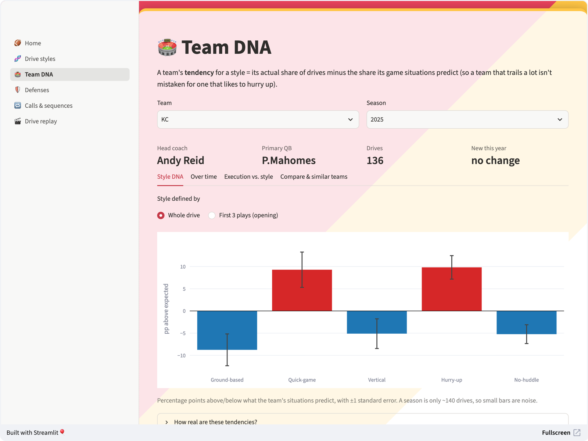

# Drive DNA

[](https://football-drive-classification.streamlit.app/)
[](https://github.com/cole11smith33/football-driveClassification/actions/workflows/tests.yml)


NFL analytics that treat the **drive** as the unit of analysis: find distinct styles of offensive
drives, see how they develop, and test what actually separates successful drives from unsuccessful
ones. Built on free [nflverse](https://github.com/nflverse) play-by-play, 2016–2025.

**[Open the live app →](https://football-drive-classification.streamlit.app/)**: explore drive styles,
any team-season's style DNA, defenses, play-call effectiveness, and a play-by-play drive replay.

[](https://football-drive-classification.streamlit.app/teams)

Guiding rule: **separate "style" from "outcome."** Styles are built only from *how* a drive was run,
never from how it ended. Effectiveness is then measured with the game situation held fixed.

## At a glance

| | |
|---|---|
| **45,907** | drives analyzed (2016–2025, garbage time, kneel-downs and end-of-half drives filtered out) |
| **5** | drive styles: Quick-game, Ground-based, Vertical, Hurry-up, No-huddle (bootstrap ARI 0.95) |
| **+0.36 pts/drive** | for a deep-shot opening vs. a typical opening in the same situation (95% CI +0.29 to +0.42) |
| **93%** | of the variance in team points per drive is execution; opening-style choices explain almost none |
| **~4×** | how much more a new head coach shifts a team's style than a new QB does |

## Findings

- **Styles are a continuum.** Five whole-drive styles are a stable, useful partition (they hold up on
  bootstrap refits and when a 2016–2020 model is compared with a 2021–2025 one), but silhouette scores
  are low for every k: they are not natural clumps.
- **The way a drive *opens* is associated with how it ends**, holding situation and team quality fixed.
  Deep-shot openers do best. See [03_effectiveness](notebooks/03_effectiveness.ipynb) for sizes,
  intervals and sensitivity checks.
- **The effect runs through progress.** After the first three plays, where the drive stands predicts
  the outcome far better than style does, and style adds nothing on top of it.
- **Teams differ in execution, not measurable style choices.** Team style tendencies are real but only
  partly persistent, follow play-callers (one coach's no-huddle fingerprint shows up at two teams), and
  move more with a new head coach than with a new QB.
- **Defenses have real scheme tendencies but only two archetypes** (aggressive vs. light). The value of
  an opening style does not detectably depend on the defense. Mid-depth passes are the reliable call,
  deep passes are boom-or-bust, and the deep-pass edge shrinks against blitzes and man coverage.

All estimates are observational: they adjust for what is measured, not for everything a coach sees.

## Approach

| Question | Method | Why this way |
|---|---|---|
| What styles exist? | Style-only features (call mix, pass depth, tempo) → length-aware shrinkage → PCA → k-means | Outcomes never enter the model. Short drives are shrunk toward the league so a 3-play drive can't land in an extreme style by chance. k is chosen by whole-pipeline stability (bootstrap and across-era ARI), not silhouette. |
| Does style change outcomes? | g-computation: outcome models with situation and team-quality controls, every drive predicted under each style | Compares a style with a typical mix *in the situations where teams actually use it*, avoiding extrapolation. Uncertainty from a bootstrap that resamples whole games. |
| Is it the style or the result? | Opening style from only the first 3 designed plays | Whole-drive style is contaminated by how the drive went (stalled drives look "hurry-up"). |
| How early can you tell? | Out-of-time prediction (train ≤ 2022, test ≥ 2023), adding context → style → progress | Tests whether style adds information beyond where the drive stands. |
| Which call sequences matter? | Mantel–Haenszel odds ratios stratified by drive length, Benjamini–Hochberg FDR | Touchdown drives are longer, so a naive comparison just rediscovers length. |
| What is a team's style? | Actual style share minus the share its game situations predict; reliability checked before comparing teams | A team that trails a lot isn't mistaken for one that likes to hurry up. |
| Do defenses moderate it? | Ridge regression with style × scheme interactions, leave-one-game-out tendencies, leave-one-season-out CV | Shrinks interactions toward zero when the signal may not exist; a drive never feeds its own opponent's tendency. |

## Notebooks

Each notebook reads the saved reports and plots; logic lives in `src/drivedna/`. They are committed
with their outputs, so the charts are readable on GitHub without running anything.

| Notebook | What it covers |
|---|---|
| [01 · Exploring drives](notebooks/01_eda.ipynb) | How drives end, style feature distributions, how game situation shifts play-calling, drives as play-token sequences |
| [02 · Drive styles](notebooks/02_styles.ipynb) | Whether natural clusters exist, choosing k by stability, style profiles, confound checks, example drives, UMAP map |
| [03 · What works?](notebooks/03_effectiveness.ipynb) | Adjusted effect of opening style, sensitivity checks, call sequences vs. touchdowns and punts, early prediction |
| [04 · Team profiles](notebooks/04_teams.ipynb) | Script-adjusted style DNA, reliability, similar teams, coaching and QB changes, execution vs. style |
| [05 · Defenses and situations](notebooks/05_defenses_situations.ipynb) | Scheme tendencies and archetypes, style × defense, which calls work where, pass depth vs. the defensive look |

## The app

[**football-drive-classification.streamlit.app**](https://football-drive-classification.streamlit.app/)
has five pages on top of the saved outputs:

- **Drive styles**: profiles, mix over time, example drives, what an opening is worth
- **Team DNA**: any team-season's script-adjusted tendencies, history with coaching changes, similar teams, execution vs. style
- **Defenses**: blitz and box tendencies for every defense-season and the two archetypes
- **Calls & sequences**: what works in the red zone, two-minute drill and fourth quarter; pass depth vs. blitzes and coverage
- **Drive replay**: step through any drive play by play with its style classification

The chart and data code lives in `src/drivedna/app/` and is unit-tested; `tests/test_app.py` drives
every page headlessly. The deployed app reads the compact tables in `data/processed/app_*.parquet`
plus `reports/`, so it runs without the raw play-by-play.

## Run it yourself

```bash
python3 -m venv .venv && .venv/bin/pip install -e ".[dev,app]"

.venv/bin/python -m drivedna.data.ingest                  # 1. download pbp -> data/raw (Parquet)
.venv/bin/python -m drivedna.drives.build                 # 1. drives + ordered plays + filter flags
.venv/bin/python -m drivedna.features.drive_features      # 2. style / rhythm / context / outcome features
.venv/bin/python -m drivedna.models.cluster               # 3. drive styles + stability reports
.venv/bin/python -m drivedna.analysis.run_effectiveness   # 4. adjusted style effects (~20 min)
.venv/bin/python -m drivedna.analysis.run_secondary       # 4. call sequences + early-drive prediction
.venv/bin/python -m drivedna.analysis.run_teams           # 5. team DNA, similarity, change events, execution
.venv/bin/python -m drivedna.analysis.run_defenses        # 6. defense tendencies, style x defense, situations
.venv/bin/python -m drivedna.app.prepare                  # 7. compact tables for the app
.venv/bin/streamlit run app/streamlit_app.py              # 7. the app (http://localhost:8501)
.venv/bin/pytest                                          # tests
scripts/execute_notebooks.sh                              # re-run notebooks, saving outputs
```

To just run the app, skip the pipeline: the committed app tables and reports are enough for
`streamlit run app/streamlit_app.py`. The notebook script saves charts as static images for GitHub;
open a notebook locally for interactive ones.

| Phase | Code | Output |
|---|---|---|
| 1 Drive table | `data/ingest.py`, `drives/build.py` | `data/processed/drives.parquet`, `drive_plays.parquet` |
| 2 Features | `features/` | `drive_features.parquet`, play tokens |
| 3 Styles | `models/cluster.py` | `drive_styles.parquet`, `reports/stability.json`, `k_stability.csv` |
| 4 What works | `analysis/effectiveness.py`, `sequences.py`, `early.py` | `reports/effectiveness.csv`, `sequences_*.csv`, `early_*.csv` |
| 5 Teams | `analysis/teams.py` | `reports/team_season_dna.csv`, `change_event_summary.csv`, `performance_decomposition.csv` |
| 6 Defenses, situations | `analysis/defenses.py`, `interactions.py`, `situations.py` | `reports/defense_season_scheme.csv`, `interaction_cv.csv`, `situation_effects_*.csv`, `depth_by_look.csv` |
| 7 App | `app/`, `src/drivedna/app/` | Streamlit app (pages above) |

## Project layout

```
src/drivedna/
  data/        download nflverse play-by-play and participation data
  drives/      build the drive table and filter flags
  features/    style, rhythm, context and outcome features; play tokens
  models/      drive-style clustering and stability checks
  analysis/    effectiveness, sequences, early prediction, teams, defenses, situations
  app/         data loading and charts for the Streamlit app
app/           Streamlit entry point and pages
notebooks/     narrative analysis with saved outputs
reports/       every table the notebooks and app read (CSV / JSON)
tests/         pytest suite, including headless app tests
```

## Testing and CI

GitHub Actions runs `ruff` and `pytest` on Python 3.10 and 3.12 for every push and pull request.
The raw play-by-play is not in the repo, so tests that need the full pipeline outputs skip in CI; unit
tests, checks on the committed reports, and the headless app tests all run.

## Stack

Python · polars · pandas · scikit-learn · statsmodels · UMAP · Plotly · Streamlit · pytest · GitHub Actions

## Data

Play-by-play and participation data come from [nflverse](https://github.com/nflverse) via
[nflreadpy](https://github.com/nflverse/nflreadpy). Thanks to the nflverse maintainers for making it freely available.
